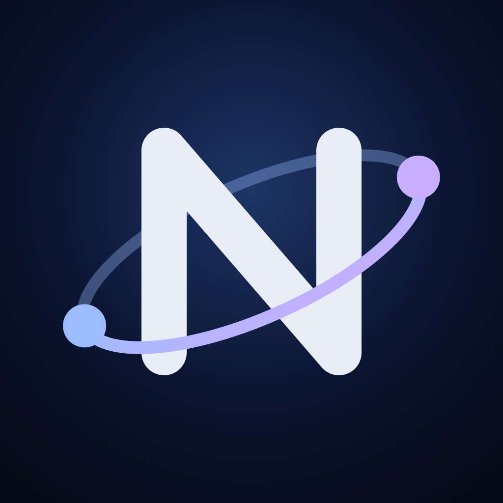
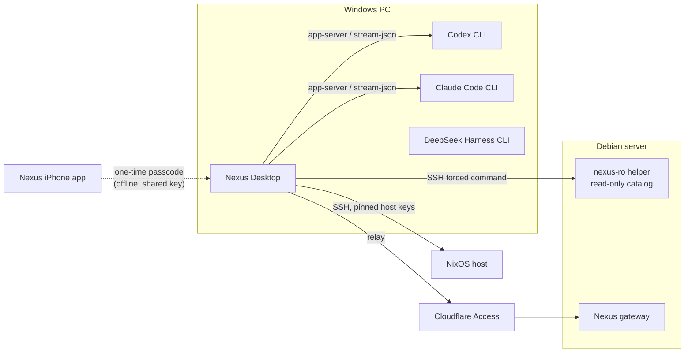

<div align="center">



# Nexus Desktop

**An AI IDE and home-lab control room for Windows, in Rust.**<br>
The Windows companion to the [Nexus iPhone app](https://github.com/ljcatherine/Nexus), in the Midnight Liquid Glass design.

[](https://github.com/ljcatherine/NexusWindows/releases)
[](rust-toolchain.toml)
[](crates/nexus-ui)
[](#ai-providers)
[](https://github.com/ljcatherine/NexusWindows/releases/latest)

[**Download**](https://github.com/ljcatherine/NexusWindows/releases/latest) ·
[Status](docs/STATUS.md) ·
[Security model](docs/SECURITY-MODEL.md) ·
[iPhone parity](docs/PARITY.md) ·
[Build &amp; release](docs/BUILD-AND-RELEASE.md)

</div>

---

## What it does

<table>
<tr>
<td width="50%" valign="top">

### IDE
Workspace explorer that honours `.gitignore`, `.cursorignore` and `.nexusignore`.
Multi-tab editor with syntax highlighting for 15+ languages, multi-cursor,
find/replace, minimap, split view and a Git gutter. Quick open, command palette,
workspace search, source control, build/test tasks with a Problems list, and
PowerShell, Command Prompt, WSL and Git Bash terminals.

</td>
<td width="50%" valign="top">

### AI
**Codex** (official `codex app-server`) and **Claude Code** (official CLI) in
Ask, Plan, Agent and Bypass modes, plus **DeepSeek Harness** agents running on
NexusAI (the PS5 model server), OpenAI-compatible APIs and PS5LM Plus.
Visible context sharing, secret detection, image and PDF attachments,
command approvals, agent edits reviewed hunk by hunk, Ctrl+K inline edits and
resumable sessions with task memory.

</td>
</tr>
<tr>
<td width="50%" valign="top">

### Infrastructure
Dashboard with live telemetry and low-resource alerts, devices with pinned SSH
host keys, services, logs, processes and network probes. SSH and SFTP terminals
for hosts you allow, NixOS dry-build and switch, Debian shadow workspaces,
Minecraft and PS5LM status.

</td>
<td width="50%" valign="top">

### Security
Every remote action goes through one policy engine in Rust. Debian is read-only
by default, enforced on the server by the `nexus-ro` helper. The owner can unlock
Debian writes for 30 minutes; agents never can. Optional app lock with a 4-digit
code from the iPhone app.

</td>
</tr>
</table>

## How the pieces fit



## Install

Grab the latest build from [**Releases**](https://github.com/ljcatherine/NexusWindows/releases/latest).
Each release has the same build in three forms:

| File | Use it when |
|---|---|
| `NexusDesktop-<version>-x64.msi` | You want a normal install with a Start menu entry |
| `NexusDesktop-<version>-x64-portable.zip` | You want to run it from a folder, no install |
| `NexusDesktop-<version>-x64.exe` | You just want the executable |

Check downloads against `SHA256SUMS.txt` in the same release. Builds are unsigned, so Windows SmartScreen may warn on first run.

To use the Cloudflare relay with your own gateway, build from source with the settings in [BUILD-AND-RELEASE](docs/BUILD-AND-RELEASE.md#your-gateway-cloudflare-access-relay).

## AI providers

| Provider | Setup | Billing |
|---|---|---|
| **OpenAI Codex** | Install the Codex CLI, run `codex login` | Your ChatGPT plan |
| **Claude Code** | Install Claude Code, run `claude auth login` (or Settings → AI providers → *Sign in…*) | Your Claude Pro/Max plan |
| **OpenAI-compatible** | Settings → AI providers → add an endpoint; keys go to Windows Credential Manager | The API's own billing |
| **PS5LM Plus** | Settings → AI providers → set its LAN URL | Local |
| **DeepSeek Harness** | `npm install -g @deepseek-ai/dsh` (Node.js 22.19+) so `dsh` is on `PATH`. With the NexusAI / PS5LM Plus URL set, its model is NexusAI ([NexusAI docs/DSH.md](https://github.com/ljcatherine/NexusAI/blob/main/docs/DSH.md)) | Local (NexusAI), else DSH's own model |

A provider only shows **Connected** after its sign-in and a real test turn both succeed. DeepSeek Harness on NexusAI
is the exception: a test turn takes about a minute on a PS5, so it shows Connected once NexusAI lists its model and
DSH composes the turn profile, and says "no test turn".

## Build from source

> [!NOTE]
> Needs Windows 10/11 x64, Rust stable (MSVC), Visual Studio Build Tools with the Windows SDK, and Git.

```powershell
cargo build --release -p nexus-app      # target\release\NexusDesktop.exe
cargo test --workspace
cargo run -p nexus-app                  # debug run
```

Releases are built and published locally, never by CI:

```powershell
powershell -ExecutionPolicy Bypass -File scripts\release.ps1
```

The app icon is drawn as SVG in [`crates/nexus-app/assets/brand`](crates/nexus-app/assets/brand) and
rendered to `.png`/`.ico` by [`scripts/render-icons.sh`](scripts/render-icons.sh).

## Security

> [!IMPORTANT]
> The Debian server also runs the Nexus gateway, so it is read-only by default.
> That rule is enforced in the Rust backend ([`nexus-security`](crates/nexus-security))
> and on the server ([`nexus-ro`](crates/nexus-ro)), not only in the UI.
> AI agents never get write access to Debian in any mode.

The full model, including the owner's timed Debian unlock and the app lock, is in
[docs/SECURITY-MODEL.md](docs/SECURITY-MODEL.md) and [docs/OTP.md](docs/OTP.md).

## Project layout

<details>
<summary><b>Crates</b></summary>

| Crate | What it holds |
|---|---|
| [`nexus-app`](crates/nexus-app) | The application |
| [`nexus-ui`](crates/nexus-ui) | Midnight Liquid Glass design system |
| [`nexus-ide`](crates/nexus-ide) | Editor engine and widget |
| [`nexus-terminal`](crates/nexus-terminal) | ConPTY terminals on `alacritty_terminal` |
| [`nexus-providers`](crates/nexus-providers) | Codex, Claude Code, DeepSeek Harness and OpenAI-compatible adapters |
| [`nexus-agents`](crates/nexus-agents) | Sessions (SQLite), snapshots, task memory |
| [`nexus-context`](crates/nexus-context) | Context sharing rules, secret scan, project instructions |
| [`nexus-workspaces`](crates/nexus-workspaces) | Workspaces, search, shadow workspaces, change sets |
| [`nexus-git`](crates/nexus-git) | Guarded Git CLI wrapper |
| [`nexus-security`](crates/nexus-security) | Policy engine, Debian rules, command catalog, audit, host keys, app-lock passcode |
| [`nexus-ro`](crates/nexus-ro) | SSH forced-command helper that enforces the read-only catalog on the server |
| [`nexus-ssh`](crates/nexus-ssh) | Grant-gated SSH and read-only SFTP |
| [`nexus-access`](crates/nexus-access) | Cloudflare Access sign-in for the gateway relay |
| [`nexus-telemetry`](crates/nexus-telemetry) | Metrics parser and history (ported from iOS) |
| [`nexus-core`](crates/nexus-core) | Device model (iOS-compatible JSON) |

</details>

<details>
<summary><b>Docs</b></summary>

| Doc | About |
|---|---|
| [STATUS](docs/STATUS.md) | What is in this release and what is verified |
| [PARITY](docs/PARITY.md) | Feature-by-feature comparison with the iPhone app |
| [SECURITY-MODEL](docs/SECURITY-MODEL.md) | Threat model and enforcement |
| [OTP](docs/OTP.md) | App-lock passcode spec shared with iOS |
| [PLAN](docs/PLAN.md) · [adr/](docs/adr) | Design decisions |
| [BUILD-AND-RELEASE](docs/BUILD-AND-RELEASE.md) | Toolchain, gateway settings, releases |

</details>

<div align="center">
<sub>Nexus Desktop · built locally, released on GitHub</sub>
</div>
